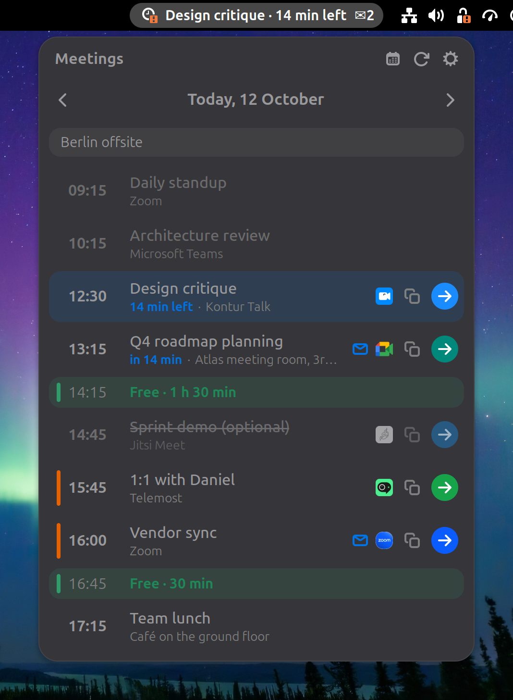
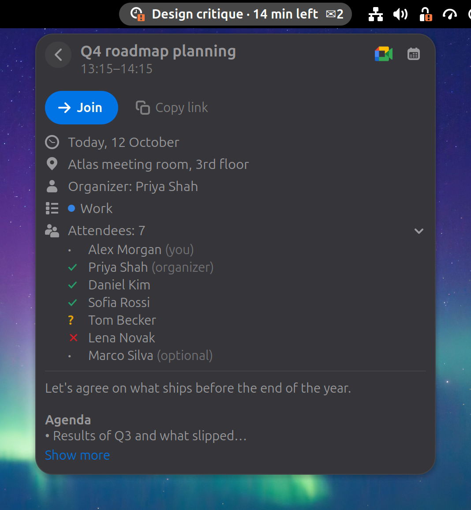
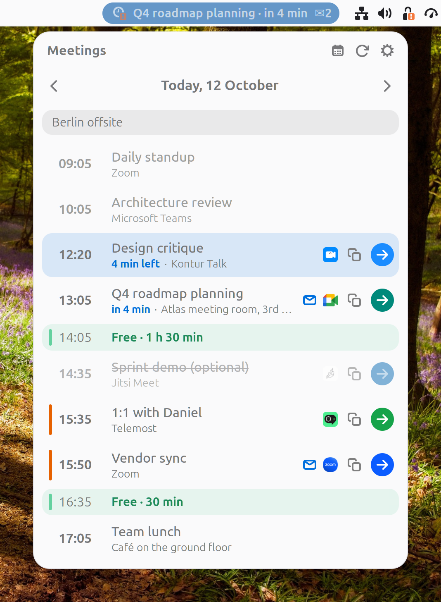
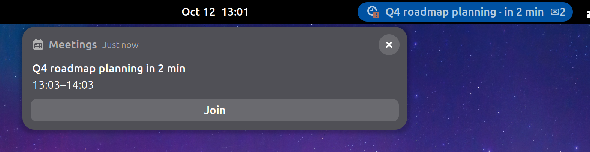
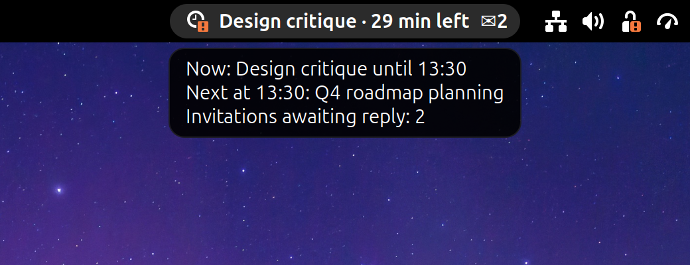

<h1 align="center">Meet Widget</h1>

<p align="center">
  <b>Your next Google Calendar meeting in the GNOME top bar, one click from the call.</b>
</p>

<p align="center">
  
  
  
</p>

<p align="center">
  
  &nbsp;
  
</p>

Meet Widget keeps a quiet countdown to your next meeting in the top bar, shows the
whole day when you click it, and gets you into the call with one click, whether
the meeting is on Google Meet, Zoom, Teams, Jitsi, Kontur Talk or Yandex Telemost.
It uses the Google account you already added in *Settings → Online Accounts*, so
there is nothing to sign in to.

Inspired by [mac-owa-widget](https://github.com/ilyabazhenov/mac-owa-widget) for macOS.

## A tour

<table>
<tr>
<td width="50%"></td>
<td>

### The day at a glance

- Past meetings fade out, the running one is highlighted with the time left.
- **Free slots** of 15 minutes or more show up between meetings, so you can see
  where the day still has room.
- **Overlapping** meetings get an orange marker. Declined ones are struck through.
- All-day events sit in a strip on top.
- An envelope next to a meeting means the invitation is still **waiting for your reply**.
- Arrows go a week back and a month ahead.

</td>
</tr>
<tr>
<td>

### One click to join

Every upcoming meeting with a call link gets the service logo, a *copy link*
button and a round **Join** button in the service's own color.

The link is found wherever the organizer put it: Google's conference data,
the location field or somewhere in the description.

| Service | Detected |
|---|---|
| Google Meet | `meet.google.com` |
| Zoom | `*.zoom.us`, including personal links |
| Microsoft Teams | `teams.microsoft.com`, `teams.live.com` |
| Jitsi Meet | `meet.jit.si` |
| Kontur Talk | `*.ktalk.ru` |
| Yandex Telemost | `telemost.yandex.ru` |

</td>
<td width="50%"></td>
</tr>
<tr>
<td></td>
<td>

### Meeting card

Click a meeting to see everything about it without leaving the menu:

- **Join** and **Copy link** right at the top.
- When, where (including booked rooms), organizer and calendar.
- Attendees with their replies: accepted, maybe, declined, no answer yet.
- The description, with its formatting and clickable links, folded to a few
  lines until you ask for more.
- **Open in Google Calendar** for anything else.

</td>
</tr>
<tr>
<td></td>
<td>

### Reminders that join

A couple of minutes before the start you get a notification with a **Join**
button. Several meetings starting together come as one notification with a
button for each.

Each meeting is reminded once, even across logouts, and the notification
disappears by itself once the meeting is over, moved or declined.

</td>
</tr>
<tr>
<td></td>
<td>

### The top bar explains itself

Hover the button to see what is going on now, what is next and how many
invitations are waiting.

The button **pulses** when it is time to join and turns into a clock while a
meeting is running.

Press **Ctrl+Alt+J** anywhere to join the current meeting. If two are running
at once, the agenda opens so you can pick.

</td>
</tr>
</table>

## Three ways to show time

Pick what the top bar says in the preferences.

| Mode | Looks like | Says |
|---|---|---|
| **Smart** (default) |  | The meeting and either the time to its start or the time left: *Design critique · 27 min left*, *Standup · in 12 min*, *at 16:30*, *tomorrow 09:30* |
| **Countdown** |  | Just the time to the next start, nothing else |
| **Status** |  | *Now · 25 min left*, *In 3 min*, *Free 40 min* |

The meeting title can be hidden for screen sharing, and the button can live on
the left, in the center or on the right of the top bar.

## Private by design

- **No separate sign-in.** Data comes from the Google account in
  *Settings → Online Accounts*. The extension has no passwords and no OAuth
  client of its own, and the access token is never written to disk.
- **Read-only.** It only reads your calendars.
- **Works offline.** The last result is cached (file mode 0600), and the countdown
  keeps going without network.
- **You choose the calendars.** Every calendar of every Google account can be
  switched on or off. Birthdays and holidays are off by default.

## Install

Requirements: GNOME Shell 50 and a Google account in *Settings → Online Accounts*
with **Calendar** turned on.

```bash
git clone https://github.com/north-leshiy/gnome-meet-widget.git
cd gnome-meet-widget
./build.sh pack
gnome-extensions install --force gnome-meet-widget@north-leshiy.github.io.shell-extension.zip
```

Log out and back in (Wayland cannot restart the Shell in place), then:

```bash
gnome-extensions enable gnome-meet-widget@north-leshiy.github.io
```

## Preferences

| Setting | Default |
|---|---|
| Remind before a meeting | 2 min (0 turns reminders off) |
| Highlight the button before a meeting | 5 min |
| Show upcoming meetings in the top bar | 3 hours ahead |
| Top bar shows | Smart |
| Show the meeting title | On |
| Place in the top bar | Right |
| Count invitations awaiting a reply | On |
| Pulse when it is time to join | On |
| Join the current meeting with Ctrl+Alt+J | On |
| Refresh every | 5 min |
| Calendars | As shown in Google Calendar |

## Limitations

- **Google only.** Exchange, CalDAV and other calendars in Evolution Data Server
  are not read.
- **Copied calendars.** Calendars that other tools fill with copies of events
  (imports from Yandex, Bitrix24, mail) don't list you as an attendee, so
  invitations there can only be answered in the source calendar.

## Development

```bash
tests/run.sh                 # unit tests of the core logic, plain gjs
tests/devkit.sh start        # isolated nested Shell with your real Google account
tests/devkit.sh shot out.png # screenshot of it
tests/devkit.sh stop
tests/screenshots.sh         # regenerate the pictures in this README
```

`extension/core/` is plain JavaScript with no GNOME imports (link detection,
merging, the agenda and top bar logic, the HTML sanitizer, reminders) and is
covered by `tests/*.test.js`. `extension/lib/` talks to GNOME Online Accounts,
the Google Calendar API and the disk; `tests/*.probe.js` exercise it read-only
against a real account.

Translations live in `extension/po/`. `./build.sh pot` refreshes the template.

## License

GPL-2.0-or-later.

Service logos in `extension/icons/` are trademarks of their owners and are used
only to show which service a call link leads to.
